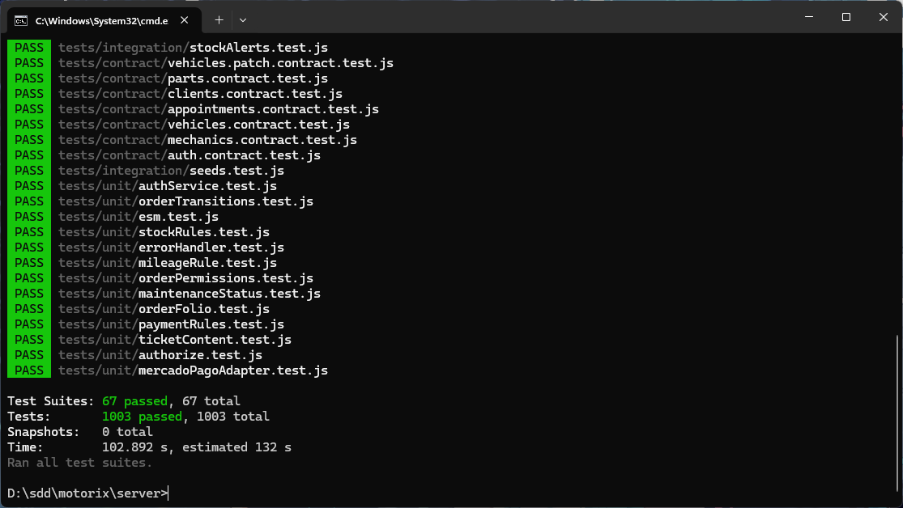
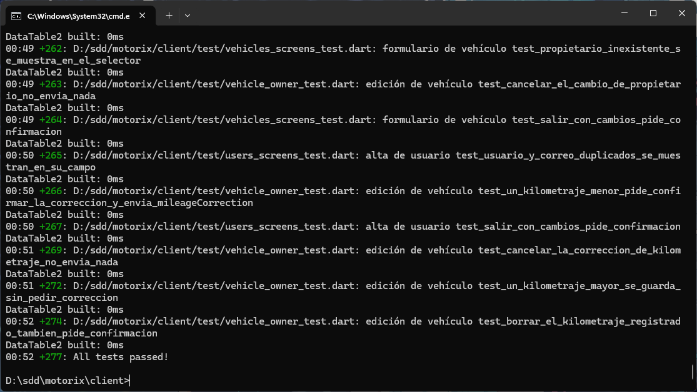

# Aseguramiento de la calidad - Sprint 5: Precios de refacciones y cobro completo

Este documento es el registro de calidad del Sprint 5. Se llena durante la preparación, antes de ejecutar `/speckit.implement`, y se completa al cierre del sprint. Al terminar se pasa a Word.

**Estados permitidos:** Pendiente · En curso · Aprobado · Aprobado con observación · Fallido · No aplica.

## 0. Datos del documento

| Campo | Valor |
|---|---|
| Sprint | 5 - Precios de refacciones y cobro completo |
| Insumo | `docs/sprints/sprint-5-precios-refacciones-cobro.md` |
| Rama | `005-precios-refacciones-cobro` |
| Responsable | |
| Fecha de inicio | |
| Fecha de cierre | |
| Estado general | Pendiente |

## 1. Objetivo y alcance

**Objetivo.** Asegurar que el Sprint 5 salga con calidad: que los requisitos estén completos, sean medibles y no se contradigan, que las pruebas estén planeadas antes del código y que el cambio no rompa lo construido en los sprints 1 a 4.

**Dentro del alcance:** categoría, marca y precios de las refacciones; total de la orden con refacciones; pago y ticket con el nuevo total; conservación de pagos y tickets ya emitidos; visibilidad del precio de compra por rol.

**Fuera del alcance:** lo que el insumo del sprint lista en su sección 8 (costeo, impuestos, descuentos, reembolsos, notificaciones, reportes, WhatsApp y puesta en producción).

## 2. Criterios de entrada y de salida

**Entrada (para permitir `/speckit.implement`):**

- [x] Las 8 puertas de la sección 3 están Aprobadas o Aprobadas con observación.
- [x] La enmienda de la constitución (hallazgo H-01, tarea T002) está aprobada y registrada: es una puerta previa a `/speckit.implement`.
- [x] Las 10 decisiones de la sección 4 están resueltas y registradas.
- [x] No hay hallazgos críticos ni altos abiertos en `/speckit.analyze`.
- [x] Cada criterio de aceptación tiene al menos una prueba planeada (sección 6).
- [x] La línea base de regresión está registrada (sección 8).
- [x] La documentación desfasada de los sprints anteriores está identificada.

**Salida (para cerrar el sprint):**

- [x] Los 14 criterios de aceptación están Aprobados.
- [x] Todas las pruebas de los sprints 1 a 4 siguen pasando.
- [x] No hay defectos críticos ni altos abiertos (sección 7).
- [ ] La matriz de calidad final (sección 9) está completa, con evidencia.
- [ ] Reporte, análisis y matriz no se contradicen.

## 3. Puertas de calidad

| ID | Puerta | Cómo se verifica | Criterio de paso | Estado | Fecha | Evidencia |
|:--:|---|---|---|---|---|---|
| G-01 | Insumo del sprint revisado | Lectura contra el código y el contexto maestro | Sin contradicciones con `project-context.md`; decisiones abiertas listadas | Aprobado con observación | 2026-10-31 | `docs/sprints/sprint-5-precios-refacciones-cobro.md` contrastado con el código (modelo de refacciones, total del cobro y ticket) y con las secciones 6.7, 6.8, 6.10 y 13 del contexto maestro; las 10 decisiones abiertas de su sección 9 quedaron listadas y se resolvieron en `/speckit.clarify`. Observación: la entidad `Part` del contexto maestro (sección 12) excluía categoría, marca y precios; se actualiza en T003 |
| G-02 | Especificación (`/speckit.specify`) | `specs/005-*/spec.md` | Historias en formato "Como... quiero... para..." y escenarios Dado / Cuando / Entonces | Aprobado con observación | 2026-10-31 | `specs/005-precios-refacciones-cobro/spec.md` y su lista de calidad. Observación: la primera versión tenía 3 marcadores de aclaración, que se resolvieron en G-03 |
| G-03 | Aclaraciones (`/speckit.clarify`) | Sección 4 de este documento | Cero marcadores `[NEEDS CLARIFICATION]` y 10 decisiones registradas | Aprobado | 2026-10-31 | Las 10 decisiones resueltas en tres rondas de clarify (sección 4) y sin marcadores en la especificación. Además se resolvió el posible doble cobro de piezas capturadas como servicio (FR-023) |
| G-04 | Lista de calidad de requisitos (`/speckit.checklist`) | `specs/005-*/checklists/` | Requisitos completos, medibles, sin ambigüedad ni contradicción | Aprobado | 2026-10-31 | `specs/005-precios-refacciones-cobro/checklists/cobro.md`: los 42 puntos revisados y resueltos con cambios en `spec.md` (H-02); CHK041 se resolvió con la enmienda 1.1.0 de la constitución (H-01) |
| G-05 | Plan (`/speckit.plan`) | `plan.md`, `data-model.md`, `contracts/` | Cumple la constitución; migración `005` aditiva; contratos de API definidos | Aprobado | 2026-10-31 | `specs/005-precios-refacciones-cobro/plan.md`, `research.md`, `data-model.md`, `contracts/` y `quickstart.md`. El principio I se cumple con la enmienda 1.1.0 de la constitución (H-01, resuelto) |
| G-06 | Tareas (`/speckit.tasks`) | `tasks.md` | Tareas ordenadas, con las pruebas antes del código y cobertura de cada historia | Aprobado | 2026-10-31 | `specs/005-precios-refacciones-cobro/tasks.md`: 63 tareas en 8 fases, con las pruebas antes del código en cada historia |
| G-07 | Consistencia (`/speckit.analyze`) | Informe del análisis | Sin hallazgos críticos ni altos; todo requisito con tarea y toda tarea con requisito | Aprobado | 2026-10-31 | Segunda pasada de `/speckit.analyze` sobre el commit `4907e8f`: 0 críticos, 0 altos, 0 medios y 2 bajos (corregidos), cobertura de 27 de 27 requisitos con 63 tareas. La puerta T002 (enmienda de la constitución, H-01) quedó resuelta con la versión 1.1.0 del 2026-10-31 |
| G-08 | Pruebas planeadas y línea base | Secciones 6 y 8 | Cada criterio de aceptación con prueba; regresión de los sprints 1 a 4 registrada | Aprobado | 2026-10-31 | Sección 6: los 14 criterios de aceptación tienen tarea y prueba planeadas (CA-14 se verifica por revisión documental). Sección 8: línea base de 1003 pruebas de backend y 277 de frontend sobre el commit `4fdfaf1`, con capturas |

## 4. Decisiones de aclaración

Las 10 decisiones pendientes de la sección 9 del insumo del sprint. No se asumen: se resuelven en `/speckit.clarify` y se anotan aquí.

| ID | Decisión pendiente | Resolución | Decidió | Fecha | Requisito afectado |
|:--:|---|---|---|---|---|
| D-01 | Refacciones existentes y líneas ya registradas sin precio: ¿se asigna 0, se exige capturar el precio o se bloquea agregarlas a una orden? | Se bloquea agregar a una orden una refacción sin precio de venta hasta que el administrador lo capture | Equipo (clarify) | 2026-10-31 | FR-015, FR-020 |
| D-02 | Orden con solo refacciones: hoy se rechaza con `NOTHING_TO_CHARGE`. ¿Pasa a ser cobrable? | Sí: es cobrable si su total con refacciones es mayor a cero | Equipo (clarify) | 2026-10-31 | FR-021 |
| D-03 | Órdenes abiertas al desplegar: ¿qué precio toman sus refacciones ya agregadas? | Cuentan con precio 0 y no suman al total; solo suman las líneas nuevas | Equipo (clarify) | 2026-10-31 | FR-015 |
| D-04 | Pago de Mercado Pago pendiente cuando cambia el total: ¿se cancela, se actualiza o se marca como desfasado? | Se señala como desfasado y la recepción lo cancela con confirmación para generar uno nuevo; no es automático | Equipo (clarify) | 2026-10-31 | FR-012 |
| D-05 | Corrección del precio de una línea de una orden abierta: ¿se permite y con qué permiso o motivo? | El precio de una línea no se edita; se quita la línea y se vuelve a agregar con el precio vigente | Equipo (clarify) | 2026-10-31 | FR-024 |
| D-06 | Categoría: ¿lista cerrada administrable o texto libre? Marca: ¿texto libre? | Ambas son texto libre de hasta 60 caracteres, sin catálogo | Equipo (clarify) | 2026-10-31 | FR-001 |
| D-07 | Precio de venta menor al de compra: ¿se permite, se advierte o se rechaza? | Se permite, con aviso y confirmación antes de guardar | Equipo (clarify) | 2026-10-31 | FR-025 |
| D-08 | Redondeo del importe de una línea y límites máximos de precio y de total. | Precio y total de la orden hasta 9 999 999.99; el redondeo no aplica (cantidad entera por precio de dos decimales) | Equipo (clarify) | 2026-10-31 | FR-002, FR-022 |
| D-09 | Cómo se muestran los tickets anteriores (sin precio de refacciones) junto a los nuevos. | Los anteriores se muestran e imprimen como se emitieron; solo los nuevos llevan precio e importe | Equipo (clarify) | 2026-10-31 | FR-008 |
| D-10 | Visibilidad del precio de venta para el mecánico. | No ve ningún precio; conserva la vista reducida actual | Equipo (clarify) | 2026-10-31 | FR-014 |

## 5. Riesgos y mitigaciones

| ID | Riesgo | Impacto | Mitigación | Prueba que lo cubre | Estado |
|:--:|---|---|---|---|---|
| R-01 | Un cambio de precio altera órdenes abiertas o documentos ya emitidos | Alto: importes incorrectos en el historial | Guardar el precio de venta en `order_parts` al agregar la refacción | | Pendiente |
| R-02 | Los pagos y tickets anteriores se muestran mal o cambian de importe | Alto | Migración aditiva; no tocar `payments` ni `tickets.content` existentes | | Pendiente |
| R-03 | Se rompe el pago único vigente al cambiar el cálculo del total (RF-05 de la matriz anterior) | Alto | Mantener las pruebas de concurrencia y de segundo pago | | Pendiente |
| R-04 | Un pago pendiente de Mercado Pago queda con un importe distinto al total | Medio | Aplicar la decisión D-04 y probar `amountOutdated` | | Pendiente |
| R-05 | El precio de compra llega al mecánico o a recepción por la API | Alto: fuga de información financiera | Proyecciones por rol en el backend y pruebas de permisos | | Pendiente |
| R-06 | Errores de redondeo en el importe de una línea | Medio | Cálculo en centavos enteros y pruebas de borde | | Pendiente |
| R-07 | Una orden con solo refacciones queda incobrable o se cobra en cero | Medio | Aplicar la decisión D-02 y ajustar `assertOrderPayable` con pruebas | | Pendiente |
| R-08 | La documentación vuelve a desfasarse del código (como el panel de 4 y 10 indicadores) | Bajo: confusión y contradicciones | Actualizar `project-context.md` y `design-system.md` dentro del sprint (CA-14) | | Pendiente |
| R-09 | El panel de control o los listados fallan con el nuevo total | Medio | Pruebas de regresión del dashboard y de los listados de órdenes y pagos | | Pendiente |

## 6. Trazabilidad

Se llena después de `/speckit.tasks` y se actualiza durante la implementación. Cada criterio de aceptación debe llegar a un resultado verificado.

| CA | Criterio de aceptación (resumen) | Requisito (FR) | Tarea | Prueba | Resultado | Evidencia |
|:--:|---|---|---|---|---|---|
| CA-1 | Refacción con categoría, marca y precios persistidos | FR-001, FR-025 | T017–T023 | T015, T016 | Aprobado | `parts.prices.test.js`, `partPrices.test.js`, `parts.contract.test.js` e `inventory_screens_test.dart` (E-07, escenario 1) |
| CA-2 | Validación de precios (negativos, no numéricos, decimales, límites) | FR-002 | T005, T017 | T014, T015 | Aprobado | `partPrices.test.js` y `parts.prices.test.js` (incluye las restricciones `CHECK` de la base) |
| CA-3 | El precio vigente se guarda al agregar la refacción a una orden | FR-004, FR-024 | T011, T028, T029 | T025, T026 | Aprobado | `orderParts.prices.test.js` y `orderParts.prices.concurrency.test.js` ([E-01](#e-01-resultado)) |
| CA-4 | Total = servicios + mano de obra + refacciones, en centavos | FR-005, FR-022 | T008, T010, T028 | T009, T025 | Aprobado | `orderTotals.test.js` y `orderParts.prices.test.js` (E-07, escenario 4) |
| CA-5 | El pago se registra por el nuevo total; importe distinto se rechaza | FR-006, FR-021 | T038 | T034 | Aprobado | `billing.parts.test.js` (E-07, escenarios 4 y 5) |
| CA-6 | Pagos y tickets anteriores conservan importe y contenido | FR-008, FR-009, FR-015 | T005, T006, T042, T044 | T047 | Aprobado | `emitted.compat.test.js` y `tickets.v2.test.js` ([E-05](#e-05-resultado)); hash de pagos y tickets intacto al migrar |
| CA-7 | El ticket nuevo detalla las refacciones, subtotal y total | FR-007 | T039, T040, T044 | T033, T035 | Aprobado | `ticketContent.test.js`, `tickets.v2.test.js` y `ticket_screens_test.dart` (E-07, escenario 5) |
| CA-8 | Un solo pago vigente, incluso con solicitudes simultáneas; sin datos de tarjeta | FR-010, FR-026 | T049 | T046, T034 | Aprobado | `payments.paidOrder.test.js` ([E-02](#e-02-resultado)) y `payments.concurrency.test.js` del Sprint 4, que sigue en verde |
| CA-9 | Mercado Pago recibe el importe correcto; pago pendiente desfasado resuelto | FR-011, FR-012, FR-027 | T038, T043 | T034 | Aprobado | `billing.parts.test.js` ([E-03](#e-03-resultado)) |
| CA-10 | El precio de compra solo lo ve el administrador | FR-013, FR-014 | T012, T055 | T052, T053, T054 | Aprobado | `prices.leak.test.js` y `orders.mechanicView.test.js` ([E-04](#e-04-resultado)); prueba de mutación |
| CA-11 | Dashboard y listados funcionan con el nuevo total | FR-016 | T058 | T058 | Aprobado | `dashboard.listings.regression.test.js` (6 pruebas) |
| CA-12 | Seeds con precios y una orden cobrable con refacciones, idempotentes | FR-017 | T050 | T048 | Aprobado | `seeds.sprint5.test.js` (12 pruebas); seed aplicado dos veces en `motorix` sin cambios |
| CA-13 | Pruebas de total, instantáneas, redondeo, permisos, concurrencia y compatibilidad | FR-019 y todos los demás | T014–T058 (las pruebas del sprint) | todas las anteriores y T059 | Aprobado | Regresión completa: 80 suites y 1215 pruebas de backend, 321 de cliente ([E-06](#e-06-resultado-del-backend)) |
| CA-14 | Documentación del proyecto actualizada | FR-018 | T003, T004, T056 | Revisión documental en T056 (sin prueba automática) | Aprobado | Revisión documental de T056 (`project-context.md`, `design-system.md`, comentarios y `README.md`) |

## 7. Hallazgos y defectos

Se registra todo lo que se encuentre, sea en los documentos, en el análisis o en las pruebas.

| ID | Descripción | Severidad (crítica, alta, media, baja) | Origen (puerta o prueba) | Estado | Resolución | Evidencia |
|:--:|---|---|---|---|---|---|
| H-01 | La constitución (principio I) fija los sprints 1 a 4; el Sprint 5 es posterior al MVP y requiere aprobación del equipo y una enmienda. Es la dependencia del punto CHK041 de la lista `cobro.md` | Media | G-04 (`cobro.md`, CHK041) | Resuelto | Enmienda MINOR 1.1.0 registrada el 2026-10-31 en el principio I, con la aprobación del responsable del proyecto (autoridad declarada por quien lo lleva, por ser un proyecto escolar) | `.specify/memory/constitution.md` |
| H-02 | La revisión de la lista `cobro.md` revisó 41 de 42 puntos y encontró huecos y ambigüedades en la mayoría (momento del total vigente, cambios de refacciones en una orden ya pagada, aprobación tardía de Mercado Pago, precio 0 frente a «sin precio», línea existente al agregar de nuevo una refacción, entre otros) | Media | G-04 (`cobro.md`) | Resuelto | Se corrigió `spec.md`: FR-006, FR-007, FR-010, FR-012, FR-013, FR-016, FR-019, FR-020, FR-022, FR-024 y los nuevos FR-026 y FR-027, además de las suposiciones y los criterios de éxito | `specs/005-precios-refacciones-cobro/checklists/cobro.md` |
| H-03 | FR-021 cambia la regla de «nada que cobrar» del Sprint 4. El plan verificó que las dos pruebas existentes (`paymentRules.test.js` y `payments.flow.test.js`) siguen vigentes porque una orden sin conceptos mantiene total cero; solo cambia el mensaje del error | Baja | G-04 (`cobro.md`, CHK024) y G-05 | Resuelto en el plan | Se confirma en la regresión al implementar (sección 8) | `specs/005-precios-refacciones-cobro/research.md` |
| H-04 | Al ampliar el contrato (FR-005, FR-013), 6 pruebas existentes de los sprints 2 y 3 dejaron de coincidir con la forma exacta de la respuesta: `orders.contract` (totales con `parts`), `seeds.sprint2` (totales con `parts`), `orderParts.contract` (3 pruebas: línea con `unitPrice`, `amount` y `legacy` para administración y recepción, y sin ellos para el mecánico) y `orderParts.flow` (detalle por rol). Se actualizaron sus aserciones; ningún comportamiento anterior cambió | Baja | Fase 2 (T010 a T012) | Resuelto | Aserciones actualizadas al contrato de `contracts/api-rest.md`; el resto de la línea base sigue en verde | `server/tests/contract/`, `server/tests/integration/` |
| H-05 | Al pasar el ticket al formato versión 2 y ampliar el bloque de cobro (FR-006, FR-007, FR-012, FR-023), 5 pruebas existentes dejaron de coincidir con la forma exacta: `payments.flow` (bloque `billing` y `details` de `PAYMENT_ALREADY_EXISTS`), `tickets.flow` (la línea de refacción ahora trae `unitPrice` e `amount`), `seeds.sprint4` (los tickets sembrados son versión 1 y ya no se comparan con `formatVersion` ni `totals.parts`) y, en el cliente, el aviso por cambio de total (ahora es el aviso de diferencia por cobrar). Se actualizaron sus aserciones; los tickets sembrados no cambiaron | Baja | Fase 5 (T037 a T040, T043) | Resuelto | Aserciones actualizadas al contrato; hash de pagos y tickets del seed 004 intacto | `server/tests/integration/`, `client/test/` |
| H-06 | Búsqueda previa a implementar FR-026 (T049): se revisaron las pruebas existentes que agregan, cambian o quitan refacciones de una orden y las que cobran una orden con refacciones. Tras activar el bloqueo, la suite completa de backend (1186 pruebas) y de cliente (316) pasó sin ajustes adicionales: ninguna prueba anterior modificaba las refacciones de una orden con pago Pagado | Baja | Fase 6 (T049) | Resuelto | Sin pruebas por actualizar por este motivo | `server/services/orderPartService.js` |
| H-07 | La prueba unitaria `test_las_refacciones_se_listan_con_cantidad_y_no_suman_importe` afirmaba justo lo contrario de FR-005 y FR-007 (que las refacciones SÍ suman). Se reemplazó por pruebas del formato versión 2 (`test_cada_refaccion_lleva_cantidad_precio_unitario_e_importe_y_el_subtotal_las_suma` y otras) y `test_incluye_todos_los_campos_requeridos` pasó a `..._con_el_formato_version_2`. Es el único cambio de regla de la línea base | Baja | Fase 5 (T033, T039) | Resuelto | Reemplazo declarado: la regla anterior quedó superada por el sprint (SC-007) | `server/tests/unit/ticketContent.test.js` |
| H-08 | Las pruebas del cliente (Flutter) de las historias 1 a 5 se escribieron junto con el código y no antes, a diferencia de las del backend, que se escribieron primero y se comprobó que fallaban. El plan pedía pruebas primero en cada historia | Baja | Fases 3 a 7 | Aceptado | Desviación de proceso sin efecto en el resultado: las pruebas del cliente cubren cada historia y pasan. Se deja constancia; en un sprint futuro conviene escribirlas antes | `client/test/` |

## 8. Línea base de regresión

Se ejecuta la suite completa **antes** de tocar el código y de nuevo **al cierre**. Ninguna prueba de los sprints 1 a 4 debe pasar de verde a rojo.

| Suite | Comando | Antes del sprint 5 | Después del sprint 5 | Diferencia | Evidencia |
|---|---|---|---|---|---|
| Backend (Jest) | `npm test` en `server/` | 67 suites y 1003 pruebas aprobadas, 0 fallidas | 80 suites y 1215 pruebas aprobadas, 0 fallidas | +13 suites y +212 pruebas | [Línea base](#e-00-resultado-del-backend) · [Cierre](#e-06-resultado-del-backend) |
| Frontend (Flutter) | `flutter test` en `client/` | 277 pruebas aprobadas ("All tests passed!"), 0 fallidas | 321 pruebas aprobadas, 0 fallidas | +44 pruebas | [Línea base](#e-00-resultado-del-frontend) · [Cierre](#e-06-resultado-del-frontend) |

**Fecha de la línea base:** 2026-10-31, sobre el commit `4fdfaf1` de la rama `004-pagos-tickets-dashboard`, antes de crear la rama del Sprint 5.

**Duración del backend:** 133 s al inicio y 60 s al cierre.

**Fecha del cierre:** 2026-11-01, sobre la rama `005-precios-refacciones-cobro`. Ninguna prueba de la línea base pasó de verde a rojo: se actualizaron las aserciones de 11 pruebas por la ampliación declarada del contrato (H-04 y H-05) y se reemplazó una que afirmaba la regla anterior (H-07). `flutter analyze lib` no reporta problemas.

## 9. Control de calidad final

Se llena al cerrar el sprint, con el mismo formato de la matriz de calidad del MVP: al menos 5 requisitos funcionales del sprint 5, con prioridad en los que pueden fallar (instantáneas, redondeo, concurrencia, permisos por rol y compatibilidad con tickets anteriores).

| ID | Requisito | Criterio de Aceptación | Prueba ejecutada | Resultado | Evidencia / defecto |
|:--:|---|---|---|---|---|
| RF-01 | Spec 005, FR-004 y FR-009: al agregar una refacción a una orden, la línea guarda el precio de venta vigente y los cambios posteriores del precio no la modifican. | Un cambio de precio posterior no altera la línea, su importe ni el total. Si el precio cambia al mismo tiempo que el alta, la línea toma el anterior o el nuevo, nunca otro valor. | Backend (Jest + supertest): `orderParts.prices.test.js` y `orderParts.prices.concurrency.test.js`, 25 casos. | Aprobado | [Requisito](#e-01-requisito) · [Prueba](#e-01-prueba) · [Resultado](#e-01-resultado). Sin defectos. |
| RF-02 | Spec 005, FR-026: una orden con un pago Pagado no admite agregar, quitar ni cambiar la cantidad de sus refacciones. | Los cuatro cambios responden `409 ORDER_ALREADY_PAID` sin tocar líneas, stock ni movimientos; con un pago pendiente se permiten; cobrar y agregar al mismo tiempo nunca deja el pago por debajo del total. | Backend (Jest + supertest): `payments.paidOrder.test.js`, 8 casos. | Aprobado | [Requisito](#e-02-requisito) · [Prueba](#e-02-prueba) · [Resultado](#e-02-resultado). Sin defectos. |
| RF-03 | Spec 005, FR-027 y FR-012: un pago de Mercado Pago pendiente cuyo importe ya no coincide con el total se señala como desfasado, y si el proveedor lo aprueba queda Pagado con su importe original mostrando la diferencia. | Aviso `outdated`; cancelarlo permite cobrar el total vigente; si se aprueba tarde, queda Pagado por el importe original, la orden muestra la diferencia y no se crea otro pago. | Backend (Jest + supertest) con proveedor simulado: `billing.parts.test.js`, 18 casos. | Aprobado | [Requisito](#e-03-requisito) · [Prueba](#e-03-prueba) · [Resultado](#e-03-resultado). Sin defectos. La diferencia se resuelve fuera del sistema, como declara la especificación. |
| RF-04 | Spec 005, FR-013 y FR-014: el precio de compra solo llega al administrador y el mecánico no recibe ningún precio de refacciones. | Recorrido de 24 rutas con cada rol buscando la clave y el valor del precio: recepción y mecánico no reciben el de compra; el mecánico no recibe precio de venta, importe de línea, desglose ni subtotal de refacciones. | Backend (Jest + supertest): `prices.leak.test.js` y `orders.mechanicView.test.js`, 23 casos, más una prueba de mutación (3 fallas al forzar una fuga). | Aprobado | [Requisito](#e-04-requisito) · [Prueba](#e-04-prueba) · [Resultado](#e-04-resultado). Sin defectos. |
| RF-05 | Spec 005, FR-008: los pagos y tickets anteriores al sprint conservan su importe y contenido, y los tickets anteriores se muestran como se emitieron. | El ticket anterior se devuelve igual al guardado, sin `formatVersion` ni precios; convive con uno nuevo (versión 2); cambiar todos los precios no altera pagos ni tickets sembrados. | Backend (Jest + supertest): `tickets.v2.test.js` y `emitted.compat.test.js`, 15 casos. | Aprobado con observación | [Requisito](#e-05-requisito) · [Prueba](#e-05-prueba) · [Resultado](#e-05-resultado). Observación: si los servicios cambian tras el pago (hueco del Sprint 4), los subtotales del ticket reflejan las líneas actuales y pueden no sumar el total, que es el importe del pago. |

## 10. Cierre

| Campo | Valor |
|---|---|
| Criterios de salida cumplidos | 3 de 5: los 14 criterios de aceptación, la regresión de los sprints 1 a 4 y sin defectos críticos ni altos. Faltan la matriz con sus capturas y la revisión final de que reporte, análisis y matriz no se contradicen |
| Defectos abiertos | Ninguno crítico, alto ni medio. H-08 (pruebas del cliente escritas junto con el código) está aceptado |
| Observaciones | Pendientes de hacer a mano: las capturas de la aplicación (E-01 a E-06) y el cronometraje de SC-001 y SC-008 con la interfaz (T060). La comprobación por API de los 10 escenarios está en E-07 |
| Aprobado por | Pendiente |
| Fecha | Pendiente |

# Anexo de evidencias

Cada evidencia tiene tres bloques, como en la matriz de calidad del MVP: **Requisito** (texto del spec con archivo y línea), **Prueba** (código o descripción) y **Resultado** (comando, salida real y captura). Las capturas se guardan en `docs/evidencias/sprint-5/` con nombres en minúsculas y guiones, por ejemplo `captura-total-con-refacciones.png`.

## E-00 Resultado del backend

Línea base del 2026-10-31, commit `4fdfaf1`, antes del Sprint 5.

Comando: `npm test` en `server/`

Pasaron las 67 suites y las 1003 pruebas; no hubo fallos.



Resultado: **Aprobado** (1003 de 1003 pruebas).

## E-00 Resultado del frontend

Línea base del 2026-10-31, commit `4fdfaf1`, antes del Sprint 5.

Comando: `flutter test` en `client/`

Pasaron las 277 pruebas; no hubo fallos.



Resultado: **Aprobado** (277 de 277 pruebas).

## E-01 Requisito

Archivo: `specs/005-precios-refacciones-cobro/spec.md`, líneas 220 a 222.

> **FR-004**: Al agregar una refacción a una orden, el sistema DEBE guardar en esa línea el precio de venta vigente en ese momento; los cambios posteriores del precio de la refacción NO DEBEN modificar la línea. Si el precio cambia al mismo tiempo, la línea toma el precio anterior o el nuevo, nunca un valor intermedio.

## E-01 Prueba

Archivos: `server/tests/integration/orderParts.prices.test.js`, líneas 57 a 68, y `server/tests/integration/orderParts.prices.concurrency.test.js`.

Se agrega una refacción de 180.00 a una orden y el administrador cambia después su precio de venta a 250.00. La línea, su importe y el total de la orden deben quedar igual. En la prueba de concurrencia, el cambio de precio y el alta de la línea se envían al mismo tiempo ocho veces: la línea debe quedar con 100.00 o con 300.00, nunca con otro valor.

Fragmento clave:

```js
const cambio = await cambiarPrecio(parte.id, '250.00');
const despues = (await detalle(admin)).body.data;

expect(cambio.status).toBe(200);
expect(despues.parts[0]).toMatchObject({ unitPrice: '180.00', amount: '360.00' });
expect(despues.totals).toEqual(antes.totals);
```

## E-01 Resultado

Comando: `npm test -- tests/integration/orderParts.prices.test.js tests/integration/orderParts.prices.concurrency.test.js`

Pasaron las 25 pruebas de las 2 suites.

Captura pendiente: `docs/evidencias/sprint-5/captura-instantanea-precio.png`.

Resultado: **Aprobado** (25 de 25 casos).

## E-02 Requisito

Archivo: `specs/005-precios-refacciones-cobro/spec.md`, líneas 299 a 301.

> **FR-026**: El sistema NO DEBE permitir agregar, quitar ni cambiar la cantidad de las refacciones de una orden que tiene un pago Pagado, y DEBE indicar que la orden ya está cobrada. Con un pago Pendiente sí se permiten, y el pago queda desfasado según FR-012.

## E-02 Prueba

Archivo: `server/tests/integration/payments.paidOrder.test.js`, líneas 61 a 74 y bloque de concurrencia.

Con una orden cobrada en efectivo, agregar otra refacción, sumar a la misma, cambiar la cantidad y quitar la línea responden `409 ORDER_ALREADY_PAID` con el mensaje «La orden ya está cobrada: no se pueden modificar las refacciones.», sin cambiar líneas, stock ni movimientos. Con un pago de Mercado Pago pendiente los tres cambios se permiten. En la prueba de concurrencia se cobra y se agrega una refacción al mismo tiempo, ocho veces: el pago nunca queda por debajo del total real de la orden.

Fragmento clave:

```js
for (const res of [agrega, mismaParte, corrige, quita]) {
  expect(res.status).toBe(409);
  expect(res.body.error.code).toBe('ORDER_ALREADY_PAID');
}
```

## E-02 Resultado

Comando: `npm test -- tests/integration/payments.paidOrder.test.js`

Pasaron las 8 pruebas. En el recorrido contra la API real (E-07), el escenario 7 obtuvo `409 ORDER_ALREADY_PAID` al agregar y al quitar.

Captura pendiente: `docs/evidencias/sprint-5/captura-orden-pagada.png`.

Resultado: **Aprobado** (8 de 8 casos).

## E-03 Requisito

Archivo: `specs/005-precios-refacciones-cobro/spec.md`, líneas 302 a 305 (y FR-012, líneas 243 a 246).

> **FR-027**: Si al consultar un pago de Mercado Pago pendiente y desfasado el proveedor lo reporta aprobado, el sistema DEBE registrarlo como Pagado con su importe original, sin modificarlo, y mostrar en la orden la diferencia entre el total y el pago. NO DEBE crear ni cobrar automáticamente la diferencia; en este sprint esa diferencia se resuelve fuera del sistema.

## E-03 Prueba

Archivo: `server/tests/integration/billing.parts.test.js`, líneas 231 a 249 y bloque «pago de Mercado Pago pendiente y desfasado».

Se crea un cobro de Mercado Pago por 1250.00 y después se agrega una refacción de 100.00 (total 1350.00). Antes de la aprobación el pago aparece desfasado y el intento de cobrar de nuevo responde `PAYMENT_ALREADY_EXISTS` con `details.outdated: true`; cancelarlo y cobrar de nuevo genera un pago por 1350.00. Si en cambio el proveedor (simulado) lo aprueba, el pago queda Pagado por 1250.00 y la orden muestra una diferencia de 100.00, sin crear otro pago.

Fragmento clave:

```js
expect(billing).toMatchObject({
  total: '1350.00',
  paidAmount: '1250.00',
  collectionStatus: 'PAGADO',
  amountOutdated: true,
  amountDifference: '100.00',
  canCharge: false,
});
expect(await pagosEnBase()).toHaveLength(1);
```

## E-03 Resultado

Comando: `npm test -- tests/integration/billing.parts.test.js`

Pasaron las 18 pruebas de la suite. En el recorrido contra la API real (E-07), el escenario 8 mostró el total 2745.00 contra un pago pendiente de 2570.00, `outdated: true` y la cancelación con confirmación.

Captura pendiente: `docs/evidencias/sprint-5/captura-pago-desfasado.png`.

Resultado: **Aprobado** (18 de 18 casos).

## E-04 Requisito

Archivo: `specs/005-precios-refacciones-cobro/spec.md`, líneas 247 a 254.

> **FR-013**: El precio de compra DEBE ser visible solo para el administrador; el sistema NO DEBE entregarlo a recepción ni al mecánico en ninguna consulta, incluidas inventario, alertas de stock, movimientos de inventario, historial del vehículo, panel de control, órdenes, pagos y tickets. [...]
>
> **FR-014**: El mecánico DEBE seguir pudiendo agregar refacciones a una orden y consultar el inventario con la información reducida que ya tenía (código, nombre, unidad y existencia), sin ningún precio: ni el de compra ni el de venta. [...]

## E-04 Prueba

Archivos: `server/tests/integration/prices.leak.test.js` y `server/tests/integration/orders.mechanicView.test.js`.

Con datos que tienen un precio de compra de 73.41 y uno de venta de 188.88, la prueba recorre 24 rutas de consulta con cada rol y busca, en cada respuesta, tanto la clave como el valor del precio. Recepción y mecánico no reciben el precio de compra en ninguna ruta; el mecánico tampoco recibe `salePrice`, `unitPrice`, `legacy`, `breakdown`, `billing`, `totals.parts` ni el importe de una línea de refacción, y las rutas de cobro le responden 403. Dos controles positivos comprueban que el administrador sí recibe el precio de compra y recepción el de venta, para que la prueba no sea vacía.

Verificación de eficacia: se forzó una fuga a propósito (el mecánico recibiendo la línea completa) y fallaron 3 pruebas; después se restauró el código.

## E-04 Resultado

Comando: `npm test -- tests/integration/prices.leak.test.js tests/integration/orders.mechanicView.test.js`

Pasaron las 23 pruebas de las 2 suites. En el recorrido contra la API real (E-07), el escenario 10 confirmó que el mecánico recibe el detalle sin precios y `403` en los pagos de la orden.

Captura pendiente: `docs/evidencias/sprint-5/captura-fuga-de-precios.png`.

Resultado: **Aprobado** (23 de 23 casos).

## E-05 Requisito

Archivo: `specs/005-precios-refacciones-cobro/spec.md`, líneas 232 a 235.

> **FR-008**: Los pagos y tickets generados antes de este sprint DEBEN conservar su importe y su contenido sin cambios y seguir consultándose e imprimiéndose exactamente como se emitieron; solo los tickets nuevos muestran precio e importe de las refacciones. El sistema distingue un ticket anterior de uno nuevo por el formato con que se emitió, no por revisar si trae precios.

## E-05 Prueba

Archivos: `server/tests/integration/tickets.v2.test.js`, líneas 136 a 148, y `server/tests/integration/emitted.compat.test.js`.

Un ticket emitido antes del sprint (sin `formatVersion`, refacciones solo con cantidad y totales sin `parts`) se devuelve exactamente igual al guardado, también al pedir «generar» de nuevo, y convive en el listado con un ticket nuevo de formato versión 2. Con los pagos y tickets del seed 004 se fotografía todo lo emitido, se cambia el precio de todas las refacciones y se comprueba que no cambió nada. Al aplicar la migración `005` en la base `motorix` se comprobó que los 9 pagos (27 420.00) y los 5 tickets conservan el mismo hash antes y después.

Fragmento clave:

```js
expect(porOrden.body.data.content).toEqual(original);
expect(porOrden.body.data.content).not.toHaveProperty('formatVersion');
expect(porOrden.body.data.content.parts[0]).not.toHaveProperty('unitPrice');
expect(porOrden.body.data.content.totals).not.toHaveProperty('parts');
```

## E-05 Resultado

Comando: `npm test -- tests/integration/tickets.v2.test.js tests/integration/emitted.compat.test.js`

Pasaron las 15 pruebas de las 2 suites. En el recorrido contra la API real (E-07), el escenario 9 mostró un ticket anterior sin `formatVersion` y uno nuevo en versión 2 en el mismo listado.

Observación: el total del ticket es el importe del pago registrado. Si los servicios o la mano de obra cambian después del pago (hueco del Sprint 4 que este sprint no cierra), los subtotales reflejan las líneas actuales y pueden no sumar ese total. Una prueba fija ese comportamiento y queda documentado en las suposiciones de la especificación.

Captura pendiente: `docs/evidencias/sprint-5/captura-ticket-anterior-y-nuevo.png`.

Resultado: **Aprobado con observación** (15 de 15 casos).

## E-06 Resultado del backend

Regresión del 2026-11-01, después de las cinco historias y del pulido.

Comando: `npm test` en `server/`

Pasaron las 80 suites y las 1215 pruebas; no hubo fallos. La línea base era de 67 suites y 1003 pruebas: hay 13 suites y 212 pruebas más. De la línea base se actualizaron las aserciones de 11 pruebas (H-04 y H-05) y se reemplazó 1 (H-07).

Captura pendiente: `docs/evidencias/sprint-5/captura-regresion-backend.png`.

Resultado: **Aprobado** (1215 de 1215 pruebas).

## E-06 Resultado del frontend

Regresión del 2026-11-01, después de las cinco historias y del pulido.

Comando: `flutter test` en `client/`

Pasaron las 321 pruebas; no hubo fallos. La línea base era de 277: hay 44 más. `flutter analyze lib` no reporta problemas.

Captura pendiente: `docs/evidencias/sprint-5/captura-regresion-frontend.png`.

Resultado: **Aprobado** (321 de 321 pruebas).

## E-07 Recorrido de los 10 escenarios contra la API real

Fecha: 2026-11-01. Se arrancó la API real (`node server.js`, puerto 3055) sobre MySQL real, con la base `motorix_test` vaciada y sembrada con los seeds 001 a 005 (para no gastar los datos de demostración de `motorix`), y un guion por HTTP ejecutó los escenarios 1 a 10 de `quickstart.md` con las cuentas de ejemplo.

| # | Escenario | Resultado |
|---|-----------|-----------|
| 1 | Registrar precios | Alta 201; recepción 403 en el catálogo; el mecánico no recibe precios |
| 2 | Venta bajo el costo | Sin confirmar 422 `PRICE_BELOW_COST`; confirmada 200; editar solo el nombre 200 |
| 3 | Refacción sin precio | `BOM-AGU` con `priceMissing`; agregarla 422 `PART_PRICE_MISSING` |
| 4 | Total con refacciones | Total 3060.00 = servicios 850.00 + mano de obra 450.00 + refacciones 1760.00; cobrable |
| 5 | Pago y ticket | Pago 3060.00; ticket versión 2 con total 3060.00 y 3 refacciones |
| 6 | Instantánea | Líneas, total, pago y ticket idénticos tras poner todos los precios en 999.00 |
| 7 | Orden pagada | Agregar y quitar responden 409 `ORDER_ALREADY_PAID` |
| 8 | Pago desfasado | Total 2745.00 contra pago pendiente 2570.00; `outdated: true`; cancelado y cobrable de nuevo |
| 9 | Compatibilidad | Ticket anterior sin `formatVersion` y nuevo en versión 2 en el mismo listado |
| 10 | Mecánico | Detalle sin precios, totales de servicios y mano de obra, pagos 403 |

Resultado: **Aprobado** (10 de 10 escenarios). Cada escenario tomó menos de 30 ms por la API.

Alcance: esta comprobación cubre la API y los datos. Los **tiempos de uso de las pantallas** (SC-001, menos de 2 minutos; SC-008, menos de 3 minutos) y las **capturas** de la interfaz siguen pendientes de hacerse a mano en la aplicación (T060), y no se dan por cumplidos.

## Modelo para nuevas evidencias

Para agregar una evidencia, copia el modelo siguiente, cambia el identificador y enlaza los tres bloques desde la columna de evidencia de la tabla correspondiente: `[Requisito](#e-01-requisito) · [Prueba](#e-01-prueba) · [Resultado](#e-01-resultado)`.

## E-01 Requisito

Archivo: `specs/005-.../spec.md`, línea N.

> (cita literal del requisito)

## E-01 Prueba

Archivo: `server/tests/...`, líneas N a M.

(qué comprueba la prueba y fragmento clave)

## E-01 Resultado

Comando: `npm test -- ...`

(salida real de la ejecución)


Resultado: **Pendiente**
