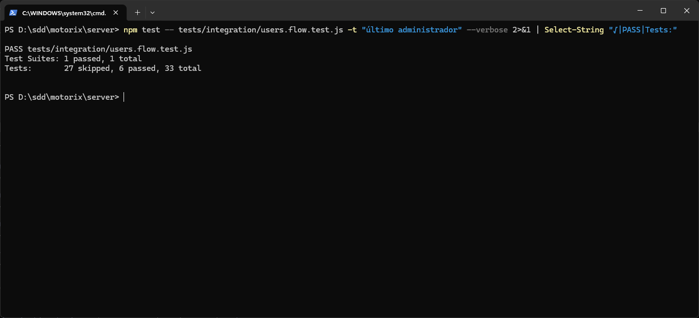
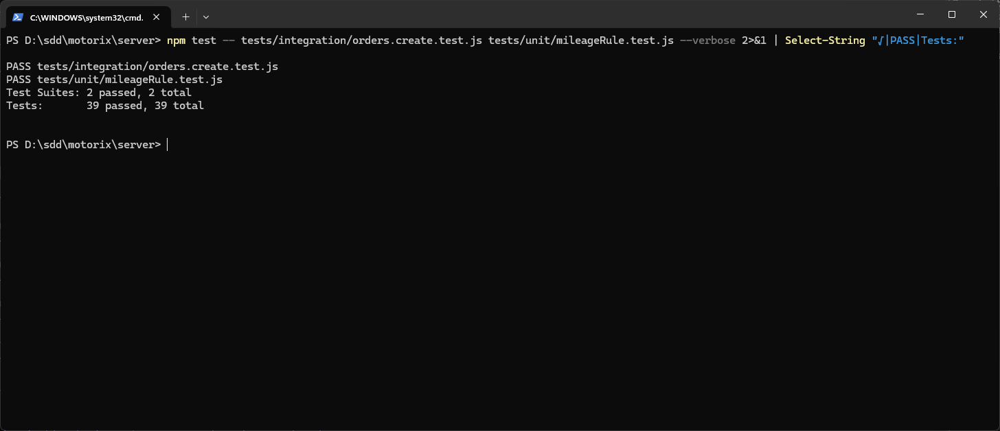
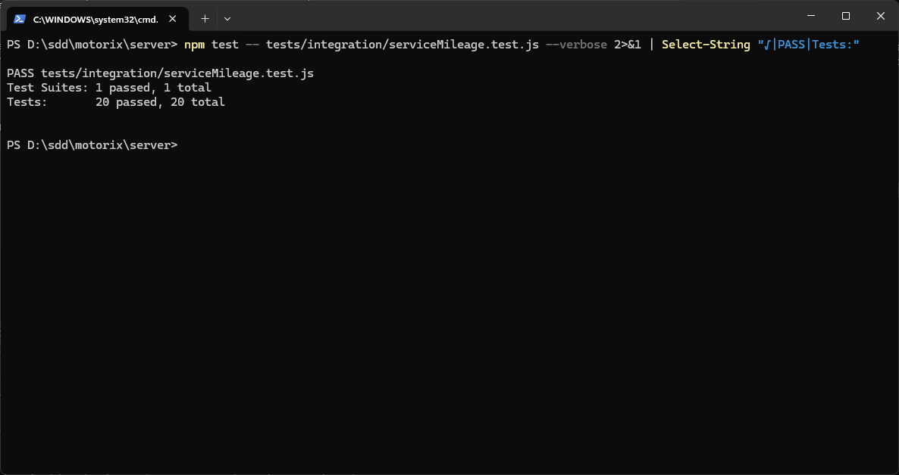
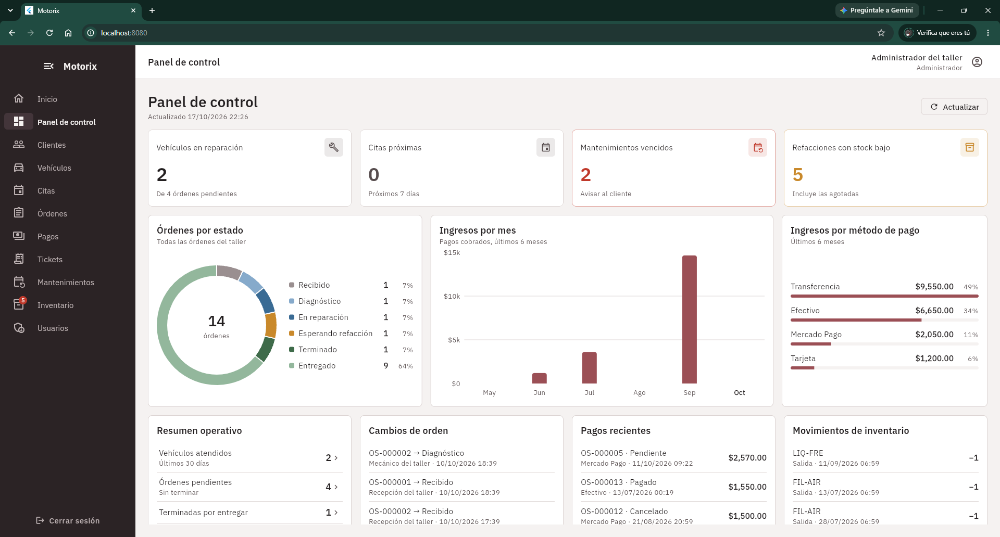
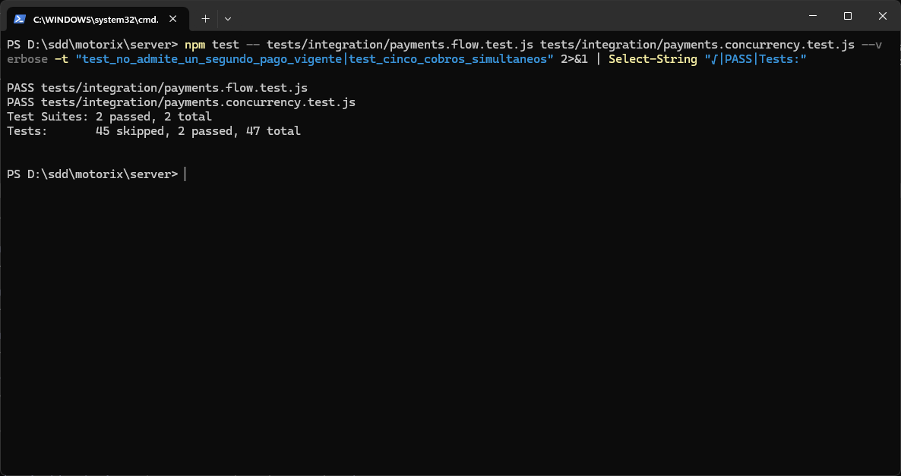

# Matriz de calidad

| ID | Requisito | Criterio de Aceptación | Prueba ejecutada | Resultado | Evidencia / defecto |
|:--:|----|----|----|----|----|
| RF-01 | Spec 001, FR-017: el sistema debe impedir que quede sin al menos un administrador activo. | Si se intenta desactivar o cambiar de rol al único administrador activo, la operación se rechaza. Si existe otro administrador activo, el cambio se permite. Un administrador inactivo no cuenta como respaldo. | Backend (Jest + supertest): `users.flow.test.js`, bloque "último administrador activo (FR-017)", 6 casos. | Aprobado | [Requisito](#rf-01-requisito) · [Prueba](#rf-01-prueba) · [Resultado](#rf-01-resultado). Sin defectos. |
| RF-02 | Spec 002, FR-009: el kilometraje de entrada de la orden es obligatorio, entero y no negativo, y no puede ser menor al actual del vehículo salvo corrección explícita con motivo y confirmación. | Un kilometraje menor al actual se rechaza sin corrección y no cambia nada. Con corrección explícita y motivo se acepta y la corrección queda registrada. Si el vehículo no tiene kilometraje previo, se acepta cualquier valor válido. | Backend (Jest + supertest): `orders.create.test.js` (bloque de kilometraje de entrada) y `mileageRule.test.js`. | Aprobado | [Requisito](#rf-02-requisito) · [Prueba](#rf-02-prueba) · [Resultado](#rf-02-resultado). Sin defectos. |
| RF-03 | Spec 003, FR-004: el mecánico asignado registra el kilometraje del servicio de una orden Terminada: entero no negativo, igual o mayor al de entrada, hasta 2 000 000, y actualiza el actual del vehículo si lo supera. | Se rechazan los valores -1, 2 000 001, 1.5, "50100" y nulo, y los menores al de entrada. Un valor válido actualiza el kilometraje del vehículo. Solo se acepta con la orden Terminada. | Backend (Jest + supertest): `serviceMileage.test.js`, 20 casos. | Aprobado | [Requisito](#rf-03-requisito) · [Prueba](#rf-03-prueba) · [Resultado](#rf-03-resultado). Sin defectos. |
| RF-04 | Spec 004, FR-017: los administradores consultan un panel de control con 10 indicadores (vehículos atendidos en 30 días, en reparación, órdenes pendientes, terminadas por entregar, citas próximas, mantenimientos próximos y vencidos, stock bajo o agotado, terminadas por cobrar y pagos de Mercado Pago pendientes). | Cada indicador se calcula con datos reales y coincide con el listado correspondiente. El panel muestra los estados vacío y error. Solo el administrador accede (recepción y mecánico reciben 403). | Backend (Jest + supertest): `dashboard.test.js` y `dashboard.contract.test.js`. Frontend (Flutter): `dashboard_test.dart`, 14 casos. | Aprobado con observación | [Requisito](#rf-04-requisito) · [Prueba](#rf-04-prueba) · [Resultado](#rf-04-resultado). Observación: `docs/design-system.md` y `docs/project-context.md` limitan el panel a 4 indicadores, mientras que el spec y el código tienen 10 (hallazgo F1 de `/speckit.analyze`). |
| RF-05 | Spec 004, FR-005: una orden tiene a lo sumo un pago vigente (Pendiente o Pagado) y se rechaza un segundo pago vigente, incluso con solicitudes simultáneas. | Un segundo pago vigente se rechaza. Con cinco cobros simultáneos con métodos distintos queda un solo pago. | Backend (Jest + supertest): `payments.flow.test.js` y `payments.concurrency.test.js`. | Aprobado | [Requisito](#rf-05-requisito) · [Prueba](#rf-05-prueba) · [Resultado](#rf-05-resultado). Sin defectos. |

# Anexo de evidencias

Cada requisito tiene tres bloques: el texto del spec (Requisito), qué comprueba la prueba y su fragmento clave (Prueba), y el comando, la captura y la conclusión de la ejecución (Resultado). Las pruebas se ejecutaron el 2026-10-26 con `npm test` en `server/` y `flutter test` en `client/`.

## RF-01 Requisito

Archivo: `specs/001-base-clientes-vehiculos/spec.md`, línea 248.

> **FR-017**: El sistema DEBE impedir que quede el sistema sin al menos un administrador activo.

## RF-01 Prueba

Archivo: `server/tests/integration/users.flow.test.js`, líneas 104 a 146.

La prueba intenta desactivar o cambiar de rol al único administrador activo y comprueba que el sistema responde con error 409 y que la base de datos no cambia. También revisa que el cambio sí se permita cuando existe otro administrador activo y que dos desactivaciones simultáneas no dejen al sistema sin administradores.

| Caso | Qué comprueba | Resultado |
|---|---|---|
| Desactivar al único administrador | Responde 409 (`LAST_ADMIN`) y el usuario sigue activo | Aprobado |
| Cambiar su rol a recepcionista | Responde 409 (`LAST_ADMIN`) | Aprobado |
| Existe otro administrador activo | El cambio se permite | Aprobado |
| Dos desactivaciones a la vez | Queda al menos un administrador activo | Aprobado |

Fragmento clave:

```js
const res = await editar(admin.id, { active: false });

expect(res.status).toBe(409);
expect(res.body.error.code).toBe('LAST_ADMIN');
const [fila] = await query('SELECT active FROM users WHERE id = ?', [admin.id]);
expect(fila.active).toBe(1);
```

## RF-01 Resultado

Comando: `npm test -- tests/integration/users.flow.test.js -t "último administrador"`

Pasaron las 6 pruebas del bloque; las otras 27 del archivo se omiten por el filtro.



Resultado: **Aprobado** (6 de 6 casos del bloque).

## RF-02 Requisito

Archivo: `specs/002-citas-ordenes-servicio/spec.md`, línea 261.

> **FR-009**: El kilometraje de entrada DEBE ser obligatorio, un número entero no negativo. El sistema DEBE rechazar un valor menor al kilometraje actual del vehículo, salvo que recepcionistas o administradores indiquen una corrección explícita con motivo y confirmación, que DEBE quedar registrada. Si el vehículo no tiene kilometraje previo, se acepta cualquier valor válido.

## RF-02 Prueba

Archivos: `server/tests/integration/orders.create.test.js`, líneas 113 a 138, y `server/tests/unit/mileageRule.test.js`.

Se crea una orden para un vehículo que tiene 50 000 km y se prueba con kilometrajes menores, con y sin corrección, y con valores fuera de rango. En cada rechazo se revisa también que no se haya guardado nada: ni la orden ni un cambio en el kilometraje del vehículo.

| Caso | Qué comprueba | Resultado |
|---|---|---|
| 49 000 km sin corrección | Responde 422 (`MILEAGE_DECREASE`), no crea la orden y el vehículo conserva 50 000 km | Aprobado |
| 45 000 km con corrección y motivo | Responde 201, registra la corrección y actualiza el kilometraje del vehículo | Aprobado |
| Corrección sin motivo | Responde 400 y pide el campo del motivo | Aprobado |
| Vehículo sin kilometraje previo | Acepta cualquier valor válido | Aprobado |
| -1, 2 000 001, 10.5 y texto | Se rechazan como valores inválidos | Aprobado |

Fragmento clave:

```js
const res = await crear(directa({ entryMileage: 49000 }));

expect(res.status).toBe(422);
expect(res.body.error.code).toBe('MILEAGE_DECREASE');
expect(await kilometrajeDelVehiculo()).toBe(50000);
```

## RF-02 Resultado

Comando: `npm test -- tests/integration/orders.create.test.js tests/unit/mileageRule.test.js`

Pasaron las 39 pruebas de las 2 suites, incluidas las 7 de la regla de kilometraje.



Resultado: **Aprobado** (39 de 39 casos).

## RF-03 Requisito

Archivo: `specs/003-historial-inventario/spec.md`, línea 278.

> **FR-004**: El mecánico asignado (y los administradores) DEBEN poder registrar el kilometraje del servicio de una orden Terminada, que DEBE ser un número entero no negativo, igual o mayor al kilometraje de entrada, y razonable (hasta 2 000 000). Si es mayor al kilometraje actual del vehículo, el sistema DEBE actualizar el kilometraje actual con ese valor.

## RF-03 Prueba

Archivo: `server/tests/integration/serviceMileage.test.js`, líneas 38 a 69.

Con una orden Terminada de un vehículo con 50 000 km de entrada, el mecánico registra distintos kilometrajes de servicio. Se comprueba el valor mínimo y el máximo permitidos, los formatos inválidos, el estado de la orden y los permisos por rol.

| Caso | Qué comprueba | Resultado |
|---|---|---|
| 50 120 km (mayor al de entrada) | Responde 200 y actualiza el kilometraje del vehículo | Aprobado |
| 50 000 km (igual al de entrada) | Lo acepta y no baja el kilometraje actual del vehículo | Aprobado |
| 49 999 km (menor al de entrada) | Responde 422 (`SERVICE_MILEAGE_TOO_LOW`) | Aprobado |
| -1, 2 000 001, 1.5, "50100" y nulo | Responde 400 (`VALIDATION_ERROR`) | Aprobado |
| Orden que no está Terminada | No se acepta en Recibido, Diagnóstico, En reparación ni Esperando refacción | Aprobado |

Fragmento clave:

```js
it.each([-1, 2000001, 1.5, '50100', null])('test_rechaza_el_kilometraje_%p_con_400', async (valor) => {
  const res = await registrar(mecanico, orden.id, valor);

  expect(res.status).toBe(400);
  expect(res.body.error.code).toBe('VALIDATION_ERROR');
});
```

## RF-03 Resultado

Comando: `npm test -- tests/integration/serviceMileage.test.js`

Pasaron las 20 pruebas del archivo.



Resultado: **Aprobado** (20 de 20 casos).

## RF-04 Requisito

Archivo: `specs/004-pagos-tickets-dashboard/spec.md`, línea 240.

> **FR-017**: Los administradores DEBEN poder consultar un panel de control con: vehículos atendidos en los últimos 30 días, vehículos en reparación, órdenes pendientes, órdenes terminadas pendientes de entrega, citas próximas (los próximos 7 días), mantenimientos próximos, mantenimientos vencidos, refacciones con stock bajo o agotadas, órdenes terminadas pendientes de cobro y pagos de Mercado Pago pendientes.

## RF-04 Prueba

Archivos: `server/tests/integration/dashboard.test.js`, `server/tests/contract/dashboard.contract.test.js` y `client/test/dashboard_test.dart`.

En el backend se arma un escenario con datos conocidos y se comprueba que cada indicador devuelva el valor esperado y que coincida con el listado del que sale. En la pantalla (Flutter) se verifican las tarjetas, la navegación a cada listado y los estados vacío y error.

| Caso | Qué comprueba | Resultado |
|---|---|---|
| Taller sin datos | Todos los indicadores en cero y las listas vacías | Aprobado |
| Escenario con datos conocidos | 3 atendidos, 2 en reparación, 4 pendientes, 2 por entregar y 1 por cobrar | Aprobado |
| Comparación con los listados | Cada indicador coincide con su listado (órdenes, mantenimientos, inventario y pagos) | Aprobado |
| Permisos | Recepción y mecánico reciben 403; sin sesión, 401 | Aprobado |
| Pantalla del panel | Valores del servidor, cada tarjeta lleva a su listado y no hay desbordes entre 760 y 1900 px | Aprobado |

Fragmento clave:

```js
expect(res.body.data.orders).toEqual({
  attendedLast30Days: 3,
  inRepair: 2,
  pending: 4,
  finishedAwaitingDelivery: 2,
});
expect(res.body.data.payments.ordersAwaitingPayment).toBe(1);
```

## RF-04 Resultado

Comandos: `npm test -- tests/integration/dashboard.test.js tests/contract/dashboard.contract.test.js` y `flutter test test/dashboard_test.dart`

Pasaron 15 pruebas de backend (12 de integración y 3 de contrato) y 14 de frontend. La captura es del panel funcionando (17-oct-2026).



Resultado: **Aprobado con observación**. Los 10 indicadores existen en el servidor (`server/services/dashboardService.js`) y en la pantalla (4 tarjetas y 7 filas del resumen operativo). La observación es documental: `docs/design-system.md` y `docs/project-context.md` hablan de 4 indicadores.

## RF-05 Requisito

Archivo: `specs/004-pagos-tickets-dashboard/spec.md`, línea 207.

> **FR-005**: Una orden DEBE tener a lo sumo un pago vigente (Pendiente o Pagado). El sistema DEBE rechazar un segundo pago vigente, incluso si dos solicitudes llegan al mismo tiempo.

## RF-05 Prueba

Archivos: `server/tests/integration/payments.flow.test.js`, línea 121, y `server/tests/integration/payments.concurrency.test.js`, línea 33.

Primero se cobra una orden en efectivo y luego se intenta un segundo cobro con tarjeta. Después se lanzan cinco cobros al mismo tiempo sobre otra orden, con métodos distintos, y se revisa en la base de datos que solo exista un pago.

| Caso | Qué comprueba | Resultado |
|---|---|---|
| Segundo cobro con la orden ya pagada | Responde 409 (`PAYMENT_ALREADY_EXISTS`) con el pago existente y en la base queda un solo pago | Aprobado |
| Cinco cobros simultáneos con métodos distintos | Solo uno se crea (201), los otros cuatro se rechazan (409) y queda un solo pago vigente | Aprobado |

Fragmento clave:

```js
const segundo = await cobrar({ method: 'TARJETA' });

expect(segundo.status).toBe(409);
expect(segundo.body.error.code).toBe('PAYMENT_ALREADY_EXISTS');
expect(await pagosEnBase()).toHaveLength(1);
```

## RF-05 Resultado

Comando: `npm test -- tests/integration/payments.flow.test.js tests/integration/payments.concurrency.test.js -t "test_no_admite_un_segundo_pago_vigente|test_cinco_cobros_simultaneos"`

Pasaron los 2 casos ejecutados; los otros 45 de las dos suites se omiten por el filtro.



Resultado: **Aprobado** (2 de 2 casos ejecutados).
